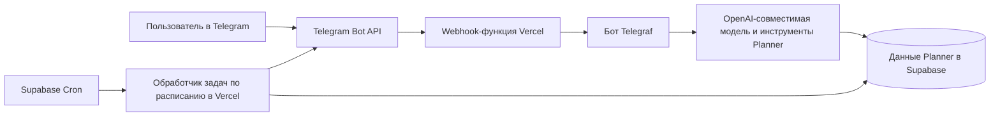

[English](README.md) | **Русский**

# Planner AI Assistant

Telegram-ассистент для личного планировщика Planner. Он читает и изменяет данные в Supabase, поэтому веб-приложение и бот работают с одним аккаунтом и общими записями.

> В этом репозитории находятся Telegram-ассистент и его конфигурация развёртывания. Веб-приложение Planner — отдельный проект, который остаётся основным приложением для работы с данными планировщика.

## Возможности

После привязки аккаунта можно писать боту обычным языком. Он поддерживает следующие действия Planner.

### Просмотр планов

- События на сегодня, задачи, просроченные задачи и отметки привычек.
- Список задач по статусу или периоду: открытые, на сегодня, просроченные, будущие или все.
- События за период, включая отдельные даты повторяющихся событий.
- Привычки и историю выполнения на выбранную дату.
- Обзор событий, задач и привычек за неделю.
- Сохранённые идеи; архивные включаются только по запросу.

### Изменение данных из Telegram

- **Задачи:** создать с необязательной заметкой, сроком и низким, средним или высоким приоритетом; изменить, завершить или удалить.
- **События:** создать и изменить название, время начала и окончания, цвет. Поддерживаются ежедневные, еженедельные, ежемесячные и ежегодные повторы с датой окончания. События можно удалять.
- **Привычки:** отметить существующую привычку выполненной на дату или отменить отметку. Создание и переименование привычек бот не поддерживает.
- **Идеи:** сохранить, просмотреть, изменить название или категорию, отправить в архив, восстановить или удалить.
- **Напоминания:** создать разовое напоминание на будущую дату и время или отменить ещё не отправленное.
- **Подтверждение удаления:** для удаления задачи, события или идеи нужно отдельное подтверждение в Telegram. Команда `/cancel` отменяет ожидающее удаление или привязку аккаунта.

Ассистент работает с ограниченным набором типизированных инструментов Planner. Языковая модель не получает возможность выполнять произвольные запросы к базе.

Например, после привязки можно спросить: «Что у меня сегодня?», «Покажи задачи на следующую неделю», «Добавь задачу позвонить врачу завтра с высоким приоритетом» или «Напомни мне отправить отчёт сегодня в 18:00». Если не хватает обязательных данных, например времени события, модель может задать уточняющий вопрос.

## Как это работает

### Привязка аккаунта

1. Пользователь входит в Planner и открывает **Профиль → Создать код подключения**.
2. Planner создаёт случайный одноразовый код. Для вошедшего пользователя Supabase сохраняет только его SHA-256 хеш. Код действует 10 минут; новый можно создать не чаще раза в минуту.
3. Пользователь отправляет боту команду `/start`, затем код.
4. Серверная функция Supabase проверяет и погашает код одной атомарной операцией, затем сохраняет соответствие Telegram ID и Supabase user ID в `telegram_users`.
5. Каждый инструмент Planner получает привязанный Supabase user ID и работает только с записями этого пользователя. Один Telegram-аккаунт связывается с одним аккаунтом Planner, и наоборот.

Для привязки Telegram не нужны email или SMTP. Браузер Planner использует публичный ключ Supabase для запроса кода от имени вошедшего пользователя. Секретный ключ Supabase используется ботом только на сервере — для погашения кода и операций Planner.

### Обработка запросов

Сообщения отправляются в настроенный OpenAI-совместимый API. Модель может выбрать только объявленные инструменты Planner. Каждый инструмент проверяет параметры и выполняет операцию Supabase в рамках привязанного пользователя. Удаление задач, событий и идей ожидает отдельного подтверждения. Даты и повторы событий интерпретируются в настроенном часовом поясе планировщика.

Отдельной команды `/help` нет. Начать или перезапустить диалог можно через `/start`. Если сессия Telegram сброшена, бот восстанавливает существующую привязку из Supabase. Команда `/cancel` отменяет текущий шаг ввода кода или подтверждения удаления.

### Напоминания и утренние сводки

Напоминания хранятся в Supabase и отправляются обработчиком по расписанию. Supabase Cron раз в минуту вызывает защищённый обработчик Vercel, который ищет наступившие напоминания и отправляет только их. Уведомлений о самом факте запуска нет. Механизм резервирования напоминаний защищает от повторной отправки одного пункта параллельными обработчиками.

Дополнительная утренняя сводка показывает события и задачи на сегодня, просроченные задачи и прогресс привычек. Она выключена, пока не задано `MORNING_SUMMARY_ENABLED=true`. Время доставки и часовой пояс настраиваются. Сводка собирается из данных Planner без отдельного запроса к ИИ.

## Данные и доступ

- Основное хранилище — Supabase. Ассистент работает с существующими таблицами Planner `tasks`, `events`, `habits` и `habit_completions`, а также с таблицей привязок `telegram_users`.
- Дополнительные функции используют отдельные таблицы: например, `ideas`, `reminders`, записи доставки сводок и хранилище сессий и полученных webhook-обновлений.
- Инструменты находят Supabase user ID через `telegram_users` и ограничивают чтение, изменения и удаление этим идентификатором.
- Ключ service-role используется только на сервере. У него расширенные права, поэтому каждый инструмент обязан ограничивать операции привязанным `user_id`. Ключ нельзя передавать браузеру, сохранять в Git или отправлять в чат.
- Нужны также разрешения PostgreSQL на таблицы: обход RLS сам по себе не даёт SQL-привилегий. SQL-скрипт привязки выдаёт боту доступ к `telegram_users`, `tasks`, `events`, `habits` и `habit_completions`, сохраняя RLS включённым.
- `.env.local` и другие локальные файлы окружения исключены через `.gitignore`. В `.env.example` находятся только имена переменных и заполнители.

Файлы в [`schema-proposals/`](schema-proposals/) настраивают развёртывание и дополнительные функции. Перед применением проверьте каждый скрипт для целевого проекта Supabase; не запускайте их в постороннем проекте.

## Структура проекта

| Путь | Назначение |
| --- | --- |
| `bot.js` | Бот Telegraf, привязка аккаунта, обработка сообщений и регистрация инструментов |
| `ai-assistant.js`, `ai-tools.js` | Работа с ИИ, определения инструментов, подтверждения и безопасный вызов операций |
| `read-tools.js` | Чтение планов, даты и часовые пояса, недельные обзоры и раскрытие повторяющихся событий |
| `task-tools.js`, `event-tools.js`, `habit-tools.js` | Операции с задачами, событиями и привычками с проверкой параметров |
| `idea-tools.js`, `reminder-tools.js` | Идеи и разовые напоминания |
| `scheduler.js`, `morning-summary.js` | Доставка наступивших напоминаний и утренних сводок |
| `api/telegram.mjs` | Telegram webhook в Vercel и защита от повторной обработки обновлений |
| `api/cron.mjs` | Защищённый обработчик расписания и очистка записей webhook |
| `supabase-session-store.js` | Постоянное хранилище Telegram-сессий для serverless-запусков |
| `scripts/set-webhook.js` | Регистрация развёрнутого обработчика в Telegram |
| `schema-proposals/` | SQL для дополнительных таблиц и настройки Supabase Cron |

## Локальный запуск

### Требования

- Node.js 22 или новее.
- Токен Telegram-бота.
- Ключ OpenAI API или данные доступа к совместимому API.
- Проект Supabase со схемой Planner и таблицей привязки аккаунтов.

### Настройка

1. Установите пакеты: `npm install`.
2. Скопируйте `.env.example` в `.env.local`.
3. Заполните обязательные переменные из таблицы ниже. Не добавляйте этот файл в Git.
4. Запустите бота в режиме polling: `node bot.js`.

Polling предназначен для локальной разработки. Развёрнутый экземпляр Vercel получает обновления через Telegram webhook.

Автоматизированные тесты запускаются командой `npm test`.

## Развёртывание на Vercel Hobby

Репозиторий настроен для Vercel Node.js Functions. Обновления Telegram принимает `api/telegram.mjs`. Задачи по расписанию обрабатывает `api/cron.mjs`, который вызывает Supabase Cron. Это позволяет не зависеть от ограничения Vercel Hobby на один запуск функции по расписанию в день.

1. Импортируйте этот репозиторий GitHub в Vercel и разверните его как Node.js-проект.
2. В **Vercel Project Settings → Environment Variables** укажите обязательные секреты и `TELEGRAM_SESSION_STORE=supabase`.
3. Примените [`schema-proposals/telegram-pairing.sql`](schema-proposals/telegram-pairing.sql) к проекту Supabase, с которым работает Planner. Скрипт создаёт функции для короткоживущих кодов, уникальные индексы и разрешения серверной роли на таблицы Planner. Оставьте RLS включённым.
4. Если ещё не применён [`schema-proposals/vercel-webhook-storage.sql`](schema-proposals/vercel-webhook-storage.sql), выполните его. Он создаёт защищённое хранилище сессий и полученных webhook-обновлений.
5. Зарегистрируйте развёрнутый адрес `/api/telegram` в Telegram командой `npm run set-webhook` из локального окружения с настроенными URL и секретом webhook.
6. Добавьте адрес обработчика Vercel и соответствующий `CRON_SECRET` в Supabase Vault. Затем проверьте и выполните [`schema-proposals/vercel-minute-cron.sql`](schema-proposals/vercel-minute-cron.sql) в Supabase SQL Editor.
7. При необходимости включите утренние сводки в переменных Vercel и настройте расписание.

Значения секретов нельзя помещать в README, GitHub, скриншоты или чат. Используйте локальный игнорируемый `.env.local` или настройки секретов соответствующего сервиса.

## Переменные окружения

| Переменная | Обязательность | Назначение |
| --- | --- | --- |
| `TELEGRAM_BOT_TOKEN` | Да | Доступ к Telegram Bot API |
| `OPENAI_API_KEY` | Да | Авторизация у провайдера ИИ |
| `SUPABASE_URL` | Да | Адрес проекта Supabase |
| `SUPABASE_SECRET_KEY` | Да, только сервер | Серверные операции Planner с расширенными правами |
| `OPENAI_BASE_URL` | Нет | Адрес OpenAI-совместимого API вместо стандартного |
| `OPENAI_MODEL` | Нет | Имя модели; настроенное значение по умолчанию указано в `.env.example` |
| `TELEGRAM_SESSION_STORE` | Для webhook в Vercel | Значение `supabase` включает постоянное хранилище serverless-сессий |
| `TELEGRAM_WEBHOOK_SECRET` | Для webhook в Vercel | Проверка запросов Telegram webhook |
| `TELEGRAM_WEBHOOK_URL` | Для локальной настройки webhook | Публичный HTTPS-адрес развёрнутого обработчика `/api/telegram` |
| `CRON_SECRET` | Для задач по расписанию | Общий секрет для защиты `/api/cron` |
| `PLANNER_TIMEZONE` | Нет | Часовой пояс планировщика; по умолчанию `Europe/Moscow` |
| `MORNING_SUMMARY_ENABLED` | Нет | Включение утренних сводок; по умолчанию `false` |
| `MORNING_SUMMARY_HOUR` | Нет | Час доставки по местному времени; по умолчанию `8` |
| `MORNING_SUMMARY_MINUTE` | Нет | Минута доставки; по умолчанию `0` |
| `MORNING_SUMMARY_WINDOW_MINUTES` | Нет | Окно доставки; по умолчанию `60` минут |
| `REMINDER_BATCH_SIZE` | Нет | Максимальное число наступивших напоминаний за один запуск; по умолчанию `50` |

## Лицензия

Лицензия пока не добавлена. Репозиторий доступен для просмотра, но права на повторное использование по открытой лицензии не предоставлены.
